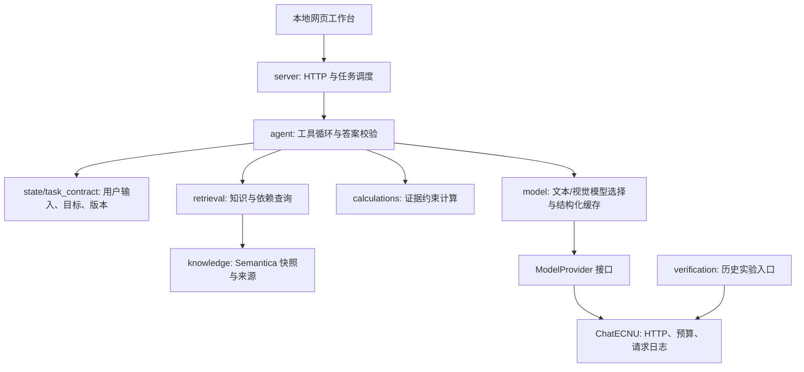

# 面试准备：架构、追问与证据边界

本说明对应 2026-11-21 的代码改进。定位为单机、单用户、具有候选知识审核机制的原型；不将离线工程测试当作业务效果或生产容量指标。

## 如何介绍项目

鹈鹕镇助手将《星露谷物语》Wiki 文本与图片区域组织为可追溯知识图谱，由动态单 Agent 按用户目标检索、补查依赖、澄清条件，并调用确定性计算工具。知识快照与用户任务状态分开保存，计算绑定本次任务版本及证据，输入变化后旧结果失效。当前原型覆盖作物、出售、加工、献祭等任务；独立截图识别优势、图谱净收益和正式任务准确率仍待验证。

## 当前架构与这轮调整



`ModelProvider` 是结构化接口约定，当前实际线上实现仍只有 ChatECNU。模型相关调用链不再导入 `verification.chatecnu`，实验入口反向复用运行时客户端。这不意味着整个应用已经移除所有实验依赖：计算和视觉模块仍复用 `verification.calculators`、`verification.vision`，属于后续可继续整理的边界。

修改前，`ModelClient` 会临时修改实验模块的全局 `BASE`，并持有覆盖网络请求全过程的锁。修改后，每个客户端持有自己的日志目录与配置；仅在预留调用次数时持有文件锁，HTTP 在锁外执行。旧实验入口保留，继续写入实验目录。新增 `request_id` 关联一次 HTTP 尝试与日志，原有模型名、耗时、usage、finish_reason 和工具调用记录继续保留。

结构化缓存键增加模型端点并升级为 `structured/v3.2`，已有提示、上下文、图片内容哈希和模型名仍参与计算。旧缓存文件保留，但不会误命中新键；因此首次使用新版本可能需要重新调用，离线时会明确报告缓存缺失。

## 高概率追问

| 面试问题 | 可以怎样回答，代码依据在哪里 | 还需要补的证据 |
|---|---|---|
| 为什么不用普通问答或普通 RAG？ | 场景包含献祭预留、剩余库存加工等跨对象依赖；图显式保存方向、条件和来源，检索后可以补查。见 `retrieval.py`、`evidence.py` | 用相同资料、工具、模型和预算进行去图关系对照，不能仅凭设计证明图更好 |
| Semantica 和 mKG-RAG 分别做了什么？你自己写了什么？ | Semantica 实际承担构图、导出和来源管理；领域层完成 Wiki 解析、图文对齐及条件校验。见 `knowledge.py`、`construction.py`、`visual.py` | 完整原版 mKG-RAG 未复现，不能声称提出联合训练算法或完成 EGTR/QM 复现 |
| 为什么用单 Agent？什么时候用固定流程？ | 当前任务在同一领域组合工具，单 Agent 可以按目标补查与追问；校验和计算使用确定规则。见 `agent.py` | Agent 有漏交付问题；固定流程可用作同预算对照，不能声称动态规划一定更好 |
| LLM 怎样调用工具？怎样避免猜价格和伪造参数？ | 工具 schema 限制字段；实体 ID 来自检索；参数绑定用户原话与任务；计算器只读签名证据包。见 `task_contract.py`、`evidence.py`、`calculations.py` | 结构校验不等于语义正确，仍需独立审核和端到端测试 |
| 多轮改数量后，如何避免旧结果混入？ | 任务有 revision，证据包绑定 task/snapshot/revision；更新和取消使派生结果失效；旧快照仍保留。见 `state.py` | 当前取消不会立即中断正在进行的 HTTP 请求，可能仍消耗一次调用 |
| 图片到底提供了什么？ | 保存真实资产、ROI、观测、对齐与证据；图片提供身份/外观线索，数值规则来自文本。见 `online_vision.py`、`visual.py` | 需要独立玩家截图；Wiki 精灵图和旧裁剪不能替代真实识别测试 |
| 怎样替换模型、做离线测试？ | `ModelClient(provider=...)` 注入满足 `ModelProvider` 的客户端；Agent 也可注入 client；测试使用假客户端或本地 MockTransport。见 `providers.py`、`model.py` | 目前只有 ChatECNU 线上实现，其他模型的工具/视觉协议仍需适配验证 |
| 文件锁有什么用？锁粒度为什么这样选？ | 同一账本的读、检查、加一、原子写回在锁内，网络请求在锁外；多个调用可同时等待远端。见 `providers.py` | 这是单机多进程文件锁，不是分布式限流，也未测生产吞吐 |
| 失败要不要重试？如何控制费用？ | 网络尝试先占用一个次数；失败也计数；没有自动重试，避免超时后重复计费。错误保留 HTTP 状态或异常类型 | 次数上限不是金额上限；未做 TPM/RPM 调度、退避策略或跨机器账户预算 |
| 实验和线上日志会不会互相污染？ | 两者通过实例日志目录隔离，不再修改模块全局变量；首次建立运行时账本可继承已有历史计数 | 独立账本后续并不自动合并，不能当作整个 API 账户的全局额度 |
| 怎样定位一次错误？ | 请求 ID 对应单次模型日志；任务保存工具事件、输入版本和计算回执，可逐层查证据断点 | 这不是完整 OpenTelemetry 链路，未实现跨服务 trace/span 或监控告警平台 |
| 缓存为什么不能只用问题文本？ | 上下文、图片、端点和模型变化都可能改变结果，均进入结构化缓存键。见 `model.py` | 模型提供方若悄悄更新同名模型，现有键不能自动识别；需要人工版本化或清理缓存 |
| Wiki 更新或删除后怎么办？ | 按来源替换或撤销贡献，重算派生知识，生成新快照，受影响记录不沿用旧批准。见 `construction.py`、`knowledge.py` | 来源修订固定不等于已确认适用游戏版本，需要领域审核 |
| 你如何证明系统有用？ | 逐题记录任务完成、数值/单位、引用支持、澄清、漏答、成本；区分开发集与独立测试。见 `evaluation_protocol.py` | 本地仍缺完整快照、原文与图片；正式金标准和独立效果评测未完成 |
| 为什么没有上微服务、多 Agent 或消息队列？ | 当前是单机原型，模块边界比部署拆分更紧迫；先解决可复现、知识可靠性和完整交付 | 没有压测依据时不应虚构 QPS、并发用户数、可用性或分布式能力 |

回答时按“问题场景 → 设计选择 → 代码实现 → 测试证据 → 局限”组织。尤其准备一次实际失败的分析，例如开放加工比较漏掉果酱：区分图中缺知识、检索未召回、未执行计算、最终答案漏交付，而不是统称模型幻觉。

## 本轮验证与复现

Windows PowerShell，在仓库根目录运行：

```powershell
.\.venv\Scripts\python.exe -X utf8 -m pytest -q tests/test_model_provider.py tests/test_platform_compatibility.py tests/test_answer_rendering.py tests/test_task_contract.py
```

macOS 将解释器路径换为 `.venv/bin/python`。本轮上述命令为 53 项通过。新增模型边界测试使用合成配置、本地 HTTP MockTransport 或注入的假客户端，没有向外发送请求；原有业务资料不在这些测试中。

- 同一账本下两次请求能同时进入模拟 HTTP 阶段，且计数不丢失。
- 运行时和历史实验的日志、账本隔离，实验模块全局路径不改变。
- 429 消耗一次额度、不自动重试；达到额度后不再发起请求。
- 请求 ID、usage 与日志一致；密钥及隐藏推理不写入日志。
- 文本/视觉模型选择、离线阻断、上下文和端点缓存隔离。

## 简历可以怎样写

可据当前代码写：

> 开发面向游戏 Wiki 的多模态知识问答与计算原型，结合 Semantica 来源追溯、动态单 Agent 和证据约束计算；实现任务版本失效、候选知识审核边界，以及可注入模型客户端、并发调用预算和结构化缓存。

个人贡献应按实际参与情况补充。不要将 AI 协助完成的实现全部描述为独立手写；应能讲清代码、取舍和验证方法。业务准确率提升、检索增益、真实截图识别率、费用下降或并发性能等数字，只能在对应实验完成后加入简历。
