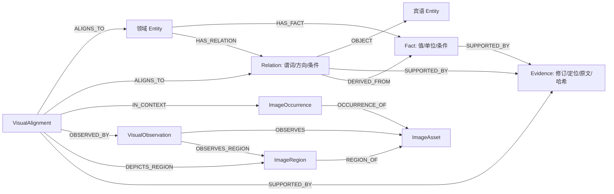
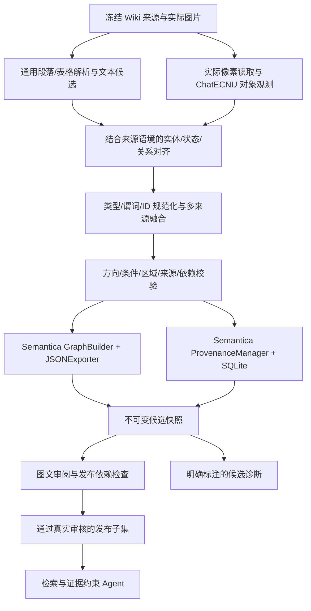

# 中期后图谱实现状态与证据

本文对应集成候选 `7269cd40e0c27ac8a0024bd0db5f10f75687b6a6bd1d6726b49f6c79b7a9b269`。它是可重载、可增量维护的候选图，不是已经人工批准的正式知识版本。构建和导入使用 `activate=False`；通过独立复现后，主流程单独切换了候选指针，正式指针保持不存在，见 [候选启用记录](../../artifacts/v3/post_midterm/candidate_activation.json)。后续 Agent 修正不改动本图谱快照。

**当前已实际走通：真实来源 → 文本/表格子图与像素观测 → 实体/状态/关系对齐 → 规范化与融合校验 → Semantica 图和来源 → 不可变候选快照 → 审阅材料；批量与增量使用相同的融合和存储过程。** 图谱集成截点的213项全仓测试通过；后续Agent版本的测试数量见[当前开发状态](POST_MIDTERM_STATUS.md)，不覆盖原日志。新进程复现通过1,279条关键记录的来源回读。工程通过不等于语义准确率已经达标。

## 1. 整体图谱是什么

图中既有游戏领域知识，也有支撑这些知识的原文、图片、出现位置和区域对象。不同对象分开编号，不能用一条图片 URL 代替视觉建图。

| 记录 | 数量 | 实际含义 |
|---|---:|---|
| Entity | 177 | 作物、种子、阶段、设备、产物、收集包等领域对象；阶段包含所属作物和顺序 |
| Fact | 212 | 主体、属性、值、单位、条件、证据；例如正常品质售价和有效生长夜数 |
| Relation | 250 | 主语、谓词、宾语、方向、条件；可独立引用、审核和接受图片说明 |
| Evidence | 790 | 来源页、修订、原文件、文件哈希、定位、原文及原文哈希 |
| ImageAsset | 95 | 已取得并校验字节的图片资产；不是只有 URL |
| ImageOccurrence | 4,732 | 同一图片在具体页面、表格、行列或正文中的一次出现 |
| ImageRegion | 113 | 原图坐标中的整图区域或对象 ROI；模型 ROI 有实际裁剪文件 |
| VisualObservation | 97 | 实际像素观测，包括对象、区域、可见描述、可见关系和不确定性 |
| VisualAlignment | 817 | 页面出现位置、观测、ROI 与实体/状态/事实/关系的显式对应 |

Semantica 导出图实际有 **7,283 个记录节点和 8,761 条连接边**。“177 个实体”仅指游戏领域实体，不是整个持久化图的节点总数。Fact 和 Relation 被表示为可引用的记录节点，因此一个关系本身也能拥有来源、条件和视觉说明。



图中只画了主要连接；Alignment 也可以指向 Fact，阶段使用类型为 CropStage 的 Entity 表示。`DERIVED_FROM` 保存派生输入依赖。Evidence 中保存来源属性，目前没有另造一个 Source 节点来冒充原文存储。

## 2. mKG-RAG 与 Semantica 实际怎样融合

两者不是两套并行知识库。mKG-RAG 提供多模态抽取、对齐、融合和检索的方法组织；领域实现把 Wiki 图文转为统一记录；Semantica 实际构图、导出并保存来源。运行时从同一个 Semantica 快照恢复记录和邻接结构，检索索引属于派生产物。



| 层次 | 已实际运行的工作 | 不能据此宣称 |
|---|---|---|
| mKG-RAG 原组件 | 固定提交 `e9cc3f5728bb8cf1d3904614532a7345db0f0f47` 的记录/mapping 解析、scene graph 格式化、ROI 裁剪和 `_handle_images_attribute`；以导入隔离方式执行原函数体，输入含真实观测和图片 | 原版自动 mapping 模型、完整原始建图入口或整篇论文已经复现 |
| 接口适配 | ChatECNU 文本/视觉调用、结构化输出、缓存键、统一记录到 Semantica 输入的转换 | 原 QM-Retriever 或 EGTR 已经加载 |
| 领域重实现 | Wiki 通用模板、像素统计和 MLLM 观测、ROI 对齐、方向和条件保留、规范化、冲突/依赖检查、来源协调与快照管理 | 这些模块就是上游原算法的原样运行 |
| Semantica 实际组件 | 0.7.0 的 GraphBuilder、JSONExporter、ProvenanceManager；关键记录与全部支持证据写入来源 SQLite，再由新进程回读 | 已采用所有 Semantica 原生消歧、冲突消解、推理或检索算法 |

原组件运行证据见 [component_run.json](../../artifacts/v3/upstream/component_run.json)，具体替换边界见 [MKG_BUILD_REUSE.md](MKG_BUILD_REUSE.md)。原版端点排序、逆向端点匹配和高连接节点整图补挂等启发式没有用于建立游戏机制关系。原版 QM、EGTR 和完整原入口仍未运行，也不是当前建图库的前置条件。

`knowledge.py` 实际使用 `GraphBuilder(merge_entities=False, resolve_conflicts=False, ...)`。因此本项目的语义规范化和冲突处理由前置领域层完成，不能把它们包装成 Semantica 原生算法的效果。

## 3. 融合、身份、来源与 ROI 的具体保证

**身份与规范化。** 关系身份覆盖主语、谓词、宾语、条件，保持方向和多谓词。Fact 保留值、单位和条件。`normalize_graph` 使用显式类型/谓词/实体政策，保存政策哈希、旧新 ID 映射、修改记录和输入/输出图哈希；迁移输出新快照，不修改旧快照。`unit=entity` 的值只按现有 ID、去前缀的规范 ID、精确名称或唯一别名解析，不凭相似拼写合并复数或同名对象。映射同步进入事实、关系、对齐及支持依赖引用。

**来源融合。** 合并实体时保留来源页和别名并集；相同资产保留 URL 别名。相同来源中的重复记录只能在载荷一致时去重或合并引用；同一 ID 对应不同载荷会拒绝。事实的值/单位冲突进入候选冲突状态，不用“最后一条覆盖前一条”伪造一致。

**视觉链。** 实际解码图片并校验资产哈希；模型对象必须有合法归一化 bbox。对齐检查出现位置、观测和 ROI 是否对应同一资产/来源上下文。新模型匹配必须引用本次观测实际返回的对象区域，不能用不存在的区域或整图占位符代替对象 ROI。持久化时还将 ROI 文件逐像素与原图对应裁剪比较，不能只填写一个正确格式的 bbox 或文件哈希。

**条件与派生。** 图片可以说明外观或文本关系，不能证明价格、天数、数量或因果机制。加工边保存输入事实 ID；派生时检查全部明确输入类别的引文，证据顺序不改变结果，矛盾类别不生成边。阶段说明依赖已有的阶段对齐和文本顺序关系，不把相邻图片当成独立的时间规则。

**单位解释需要共同依据。** `growth_nights` 是项目解析契约中的“有效夜间生长推进次数”，不是将任意 `days` 一律替换为 `nights`。Kale 的 `fact:7ad705c7e41c8a29cd2525466702` 数值为 6，原文证据 `evidence:6599c9509164877373a56e5ac152` 仅标注基础生长时间 6 天；Calendar 的 `fact:dc5690125a3fa04643aa0192f9e3` / `evidence:605fe493c3ae96343a83007cd29a` 来自 Crops 修订 193979，说明未浇水当夜不生长以及生长期的浇水前提。若回答使用“有效生长夜晚”，检查器需要看到单位定义和真正进入当前证据闭包的两类依据，不能暗中补入未检索的 Calendar 内容。当前图中没有独立的 `unit_normalization` 元数据接口；解析单位、计算规则依赖与原始引文需清楚区分。基础单位解释不能外推到漏浇水、加速条件或保证任意 6 个自然日成熟。

最终 817 条对齐的状态分布如下，**没有一种自动状态等同人工批准**：

| 确认等级 | 数量 | 含义 |
|---|---:|---|
| `structural_candidate` | 705 | 页面结构/链接语境候选，像素可读不代表身份得到独立视觉确认 |
| `structural_illustration` | 85 | 图片说明已有文本阶段关系，不从图片推断天数 |
| `legacy_model_candidate` | 23 | 保留旧模型/复合图产物，不追认成新 ROI 契约下的确认 |
| `visual_checked` | 4 | 本轮模型检查通过对象 ROI 契约，仍需人工核对语义 |

最终质量报告另有 20 项未知实体类型、61 项未知谓词和 23 条旧模型对齐未达到新确认契约的提示。这些候选被保留并显式报告，没有为提高通过率而擅自改成已知类别。质量报告中的依赖结构 PASS 只表示记录引用和派生链检查通过，不能替代真实批准。

## 4. 来源更新和删除怎样真正生效

最终注册表包含 **26 页完整来源贡献和 31 个旧规则/关系组件**，已不依赖“旧 24 页只能作为不可拆聚合基座”的临时限制。

1. 原 24 页由真实归档的 `documents/*/fused_document_graph.json` 恢复，原非派生记录 ID 遗漏为 0。
2. Bundles 使用原文本、观测和对齐产物恢复；区域元数据仅按组件明确引用的 ID 取回，并验证真实裁剪。注册表标注为“原组件重构”，不声称它是原先完整保存的抽取文档，也不按页面猜分聚合快照。
3. 原 `verification/data/graph_input.json` 中明确的 `fact_id` / `support_fact_ids` 恢复为 23 个事实组件和 8 个关系组件。各组件绑定实际支持证据的来源 ID。
4. `reconcile_contribution_registry` 按页替换完整贡献或撤销该页；不把旧页和新版页做永久并集。来源绑定变化后，相关旧组件失效，其他仍有独立来源支持的知识继续保留。
5. 重新融合所有保留贡献，并重算加工边和阶段说明，再规范化、校验、构建新 Semantica 快照。受影响证据集合发生变化的记录不继承旧批准。
6. 注册表和导入报告保存原产物路径/哈希、来源修订/哈希、新增、撤销、变化、复用以及派生语义差异；无变更重放复用同一快照。

实际运行已证明：撤销 Radish 两页后，图内容哈希与恢复后的旧 24 页图完全相同；撤销旧 Melon 页后，该页来源证据退出当前图，2 个绑定该来源的旧关系组件失效，而 Melon Seeds 仍支持的阶段知识保留。这些是在非激活诊断快照上的来源管理操作，不是伪造 Wiki 新修订。

对应产物：[来源恢复报告](../../artifacts/v3/post_midterm/source_recovery/result.json)、[最终来源注册表](../../artifacts/v3/post_midterm/incremental/post-midterm-integrated-fdb33176eaa54a0a9967/source_registry.json)、[实际增量重放检查](../../artifacts/v3/post_midterm/incremental_replay_checks.json)。

## 5. 审核和发布边界

`audit_release_dependencies` 递归检查事实、关系和对齐的支持依赖、类型、缺失输入及循环。派生关系不能仅凭自己的批准跳过基础事实。`assess_capabilities` 支持 AND、OR 和条件分支，区分 `NEEDS_INPUT`、`PENDING_REVIEW`、`MISSING_KNOWLEDGE`、`NOT_APPLICABLE` 和依赖错误；一个未审替代分支不应阻断已审可用分支。规则批准还须匹配实际实现指纹。

发布生成独立快照，只保留真实批准的关键记录，以及它们实际引用的 Evidence 闭包。直接证据查询不能因此访问未进入审核闭包的候选引文。实体/资产可保留索引身份，但不能据此把未经批准的内容用于正式答案。候选诊断与正式回答必须保持区分。

当前人工审核材料已经生成：[18 条代表性图文证据清单](../../artifacts/v3/post_midterm/review-integrated/待审证据清单.md)、[图文浏览页](../../artifacts/v3/post_midterm/review-integrated/index.html)、[完整 1,279 条关键记录队列](../../artifacts/v3/review/7269cd40e0c27ac8a0024bd0db5f10f75687b6a6bd1d6726b49f6c79b7a9b269/queue.json)。代表清单不是全部记录的审核替代。生成命令退出码为 **2 / PENDING_HUMAN**，这是如实保留的人工审核门槛，不是已通过发布。

## 6. 实际运行、退出状态和复现入口

所有执行记录包含真实命令、退出码、stdout/stderr 和当次代码清单；完整账本为 `artifacts/v3/execution.jsonl`。

| 已运行工作 | 退出状态与结果 | 实际产物/执行记录 |
|---|---|---|
| 原 mKG-RAG 函数组件 | exit 0；限定组件执行通过 | [原组件日志](../../artifacts/v3/execution/20261112T074703.185664Z-02-07-original-components/stdout.log) |
| Radish 新页在线建图 | exit 0；候选链完成；4 个选定视觉资产仅 2 成功，另有超时和无对象 | [新页结果](../../data/post_midterm/radish_diagnostic_v2/result.json)、[执行日志](../../artifacts/v3/execution/20261117T115937.251823Z-P03-P04-new-page-online-v2/stdout.log) |
| 旧 24 页真实来源恢复 | exit 0；原非派生 ID 遗漏 0，旧依赖解析未决 0 | [恢复日志](../../artifacts/v3/execution/20261117T122834.782370Z-P04-recover-original-source-lineage/stdout.log) |
| 完整主候选增量集成 | exit 0；26 页及来源组件导入，未激活 | [集成日志](../../artifacts/v3/execution/20261117T123314.589368Z-P04-integrated-replayable-final/stdout.log) |
| 无操作/新页撤销/旧页撤销 | exit 0；三个实际状态变化检查通过 | [增量日志](../../artifacts/v3/execution/20261117T123524.291612Z-P04-integrated-incremental-replay-checks/stdout.log) |
| 图谱相关回归 | exit 0；58 passed | [图谱测试日志](../../artifacts/v3/execution/20261117T123525.442029Z-P02-P05-integrated-graph-regression/stdout.log) |
| 全仓回归 | exit 0；213 passed | [全仓测试日志](../../artifacts/v3/execution/20261117T123847.110657Z-P12-integrated-full-suite/stdout.log) |
| 新进程复现 | exit 0；1,279 条来源回读 PASS；7 个保护文件无变化；无网络调用 | [复现报告](../../artifacts/v3/post_midterm/reproduce-integrated.json) |
| 最终图文审核材料 | exit 2；PENDING_HUMAN，无人工签署 | [审核材料日志](../../artifacts/v3/execution/20261117T124555.088619Z-P05-final-review-packet/stdout.log) |

另保留了新页采集的沙箱 DNS 失败、公开 HTTP 403，以及模型适配器变化导致的冻结哈希检查失败。后来通过正常浏览器获得真实 DOM 和原 URL PNG，标注 `browser_rendered_dom` / `browser_page_asset_export`；没有把浏览器 DOM 伪称 HTTP 原始响应。适配器变更后重新冻结 v2 协议。失败与调整见 `data/post_midterm/radish_diagnostic_v1/` 及其执行日志。

已运行的全仓回归和新进程复现命令：

```bash
.venv-repro/bin/python -m pytest -q tests
.venv-repro/bin/python scripts/post_midterm_reproduce.py \
  --snapshot 7269cd40e0c27ac8a0024bd0db5f10f75687b6a6bd1d6726b49f6c79b7a9b269 \
  --output artifacts/v3/post_midterm/reproduce-integrated.json
```

实际主候选导入命令：

```bash
.venv-repro/bin/python scripts/post_midterm_integrate.py \
  --base-snapshot c704b0819193e793a6f5088b3d2dac57363698cd687bb74e5eb6ae3e8cddf303 \
  --registry artifacts/v3/post_midterm/source_recovery/source_registry.json \
  --document data/post_midterm/radish_diagnostic_v2/pages/Radish/fused_document_graph.json \
  --document data/post_midterm/radish_diagnostic_v2/pages/Radish_Seeds/fused_document_graph.json \
  --label post-midterm-integrated
```

后续来源替换使用最终注册表和新的完整页贡献；来源撤销用 `--remove-page PAGE_ID`。脚本不激活指针。旧文档、原来源、旧快照和失败日志继续保留。当前快照内容相同的重放会复用原 snapshot ID，所以执行注册表的 build 名可与快照首次创建时 manifest 的 build 名不同；以 snapshot ID、注册表哈希和图内容哈希核对身份。

## 7. 还不能视为完成的验收

- 人工尚需核对关键事实、条件、实体归并、视觉对象和关系说明，并批准所需规则；测试中的隔离合成批准不是生产批准。
- 新页结构期望由开发助手预先声明，公开文本已经被助手看过；它是开发诊断，不是盲测或独立金标准。4 条对象 ROI 模型检查不代表整体视觉准确率。
- 原 Wiki 精灵图不是用户真实游戏截图；2 次视觉失败没有隐藏或补成成功。未知类型/谓词也没有自动成为可用业务知识。
- 已发现一个具体的视觉语义错误：`Radish_Stage_5.png` 的 `observation:373741f01228008212b3a8b7755c` 声称叶部与根部由 `connected_by_visible_arrow` 连接，但实际小精灵图没有可见箭头。该关系只保留在未审 VisualObservation 的候选载荷中，没有生成领域 Relation，Semantica 连接边中该谓词数量也为 0。相关两条 stage 5 对齐虽通过对象 ROI 契约、标为 `visual_checked`，其 `review_status` 仍是 `candidate`；这再次表明 ROI 合法和模型再次同意，不足以证明观测语义正确。正式使用前需要人工纠正/拒绝该观测关系并重新核对受影响对齐，不能把未生成错误游戏边描述为视觉识别完全成功。
- 来源发生真实修订后，旧绑定组件需要重新抽取才能恢复；来源撤销测试证明失效机制，不等于已抓取并比较所有 Wiki 真实历史修订。
- 图谱集成工程测试和2个离线算术烟雾样例不证明产品整体有用、图结构优于公平基线或完整任务准确率达标。这些结论仍须由独立样例、正式审核和受控对照给出；下一轮新页面构图语义对照及真实来源修订验收见[计划6.1](POST_MIDTERM_DEVELOPMENT_PLAN.md#61-图文建图评测)。

实现入口：`construction.py`（来源协调/派生）、`normalization.py`（规范化/迁移）、`visual.py` 与 `knowledge_quality.py`（真实视觉与校验）、`knowledge.py`（Semantica/快照/发布）、`capabilities.py`（递归依赖/能力分支）。上述核心代码在本文写作时保持冻结。
